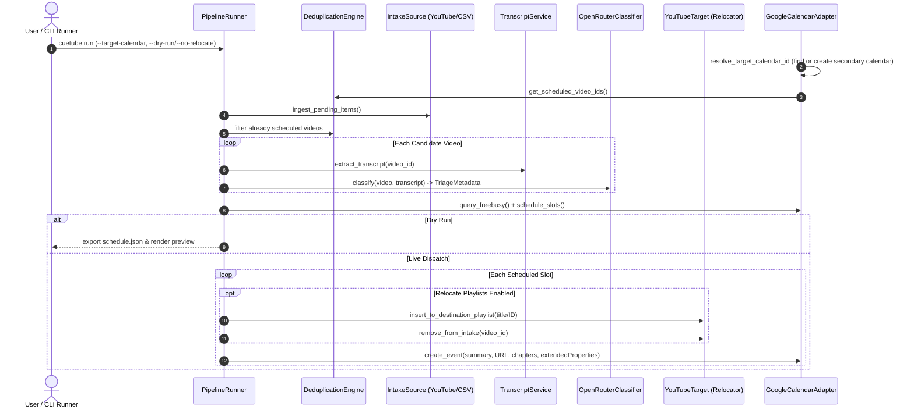

# Architecture

## Design Principles
- **Deep Modules**: High behavioural depth behind compact interfaces.
- **Explicit Seams**: Seams exist where external drivers vary (YouTube APIs, calendars, LLM providers).
- **Testability**: Interfaces accept dependencies, return pure data structures, avoid side-effect leakage.

## System Topology

```
[YouTube Source] ──(Seam: Ingestion)──> [Ingestion Module]
                                                 │
                                           Video Items
                                                 ▼
[Transcript APIs] ──(Seam: Extraction)──> [Extraction Module]
                                                 │
                                           Transcripts
                                                 ▼
[LLM Provider] ──(Seam: Classification)──> [Classification Module]
                                                 │
                                           Triage Metadata
                                                 ▼
[Calendar API] ──(Seam: Calendar)───────> [Scheduling Module]
                                                 │
                                            Schedule Plan
```

## Pipeline Execution Flow



## Seams & Adapters Matrix

| Module | External Seam | Adapters |
|---|---|---|
| `ingestion` | Playlist / Queue Source | YouTube Data API v3 (`CustomPlaylistAdapter`), Takeout CSV (`TakeoutArchiveAdapter`) |
| `extraction` | Transcript Extraction | YouTube Transcript API (`OfficialTranscriptAdapter`), Browser Fallback |
| `classification` | Inference Engine | OpenRouter API (`OpenRouterClassifierAdapter` / `GeminiClassifierAdapter`), Rule-based Mock |
| `scheduling` | Calendar Target | Google Calendar API (`GCalAdapter`), iCal Export (`ICalFileAdapter`) |
| `pipeline` | Orchestration | CLI Runner, Scheduled Cron / Worker |

## Product & Delivery Roadmap

1. **Phase 1: PyPI Reusable Library & CLI (Build Phase)**:
   - Package core domain and pipeline harness into an installable library distributed on PyPI as `cuetube` (`pip install cuetube`).
   - Deliver companion CLI for local execution, scheduled background runs, and developer pipelines.
2. **Phase 2: Full-Fledged Web & Mobile Application (Post-Build Phase)**:
   - Backend service layer wrapping the CueTube library.
   - Centralized OAuth 2.0 flow removing personal Google Cloud Console and API key requirements for end users.
   - Dedicated cross-platform web and mobile frontends for interactive queue selection, visual calendar dashboards, and automated backlog processing.
