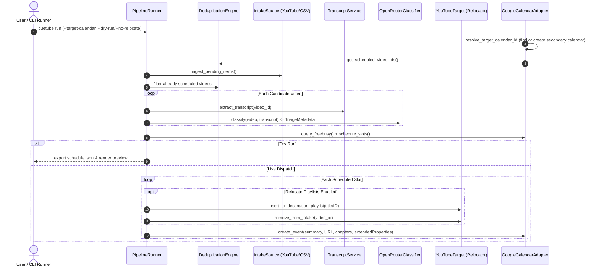

# Unified CLI Runner and Autonomous Pipeline Orchestration

Autonomous backlog processing requires reliable end-to-end execution across ingestion, transcript extraction, LLM cognitive triage, chronobiological slotting, and multi-service mutations (Google Calendar event insertion and YouTube playlist moves). We provide a unified command-line entrypoint (`cuetube run`, `cuetube daemon`) and headless orchestrator factory (`PipelineConfig.from_env`) with zero core dependencies. To ensure operator safety and visibility, the runner supports dry-run planning, pure stdlib RFC 5545 iCalendar and JSON exports (`cuetube.adapters.export`), circadian energy-level Google Calendar event color coding (`colorId`), and an interactive schedule confirmation gate (`--confirm`). Transient video-level failures are isolated to preserve batch progress without crashing the orchestrator.

## Orchestration Sequence Flow

